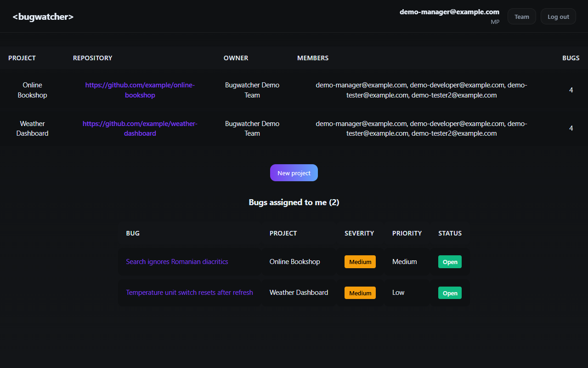
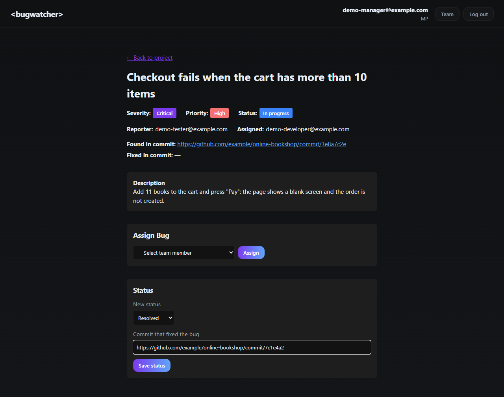
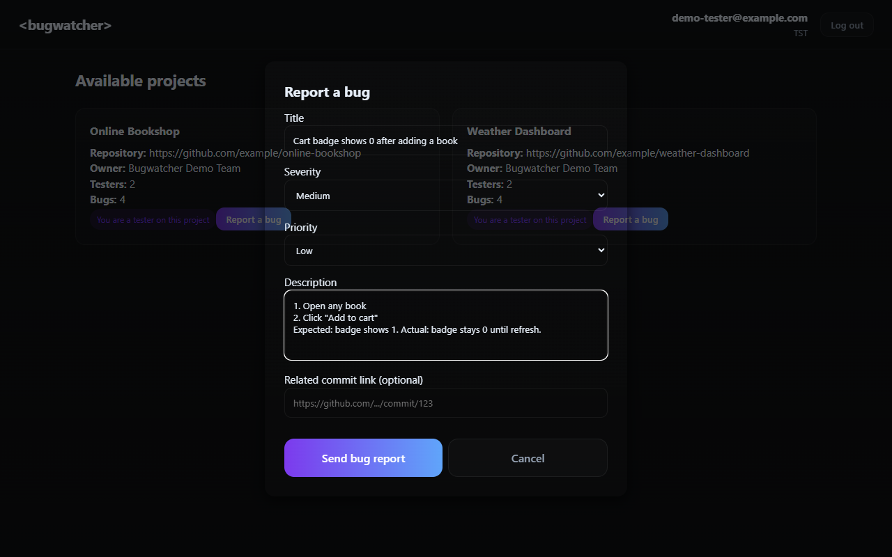
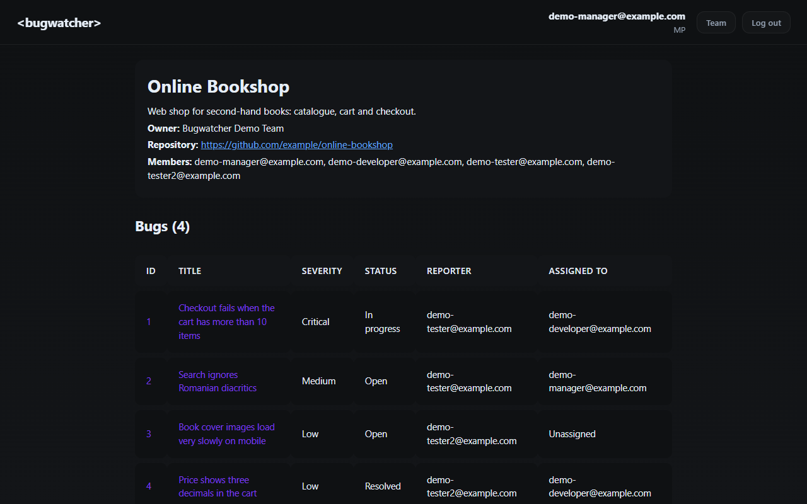
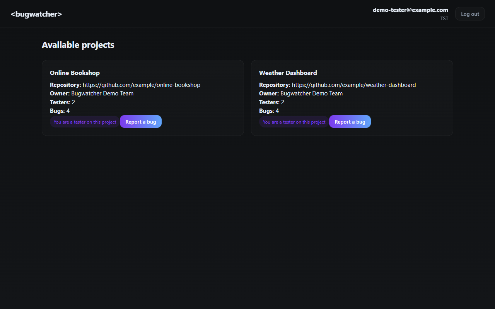

# Bugwatcher

[](https://github.com/xwmara/Bugwatcher/actions/workflows/ci.yml)

A bug tracker for small teams. Project members create projects, testers join them and report bugs,
and the team assigns each bug, follows its status and links the commit that fixed it.

**Live demo:** https://bugwatcher.vercel.app

| Role | Email | Password |
|---|---|---|
| Project member (MP) | `demo-manager@example.com` | `BugwatcherDemo2026` |
| Tester | `demo-tester@example.com` | `BugwatcherDemo2026` |

> The API runs on Render's free plan and sleeps after 15 minutes without visitors,
> so the first request can take up to about 50 seconds. After that it is fast.



## Features

**Project members (MP)**
- Create projects linked to a GitHub, GitLab or Bitbucket repository
- Create a team and add other project members; projects created in a team belong to the whole team
- Assign bugs to team members and move them through Open → In progress → Resolved → Closed
- Resolving a bug requires the link to the commit that fixed it
- "Bugs assigned to me" on the home page, most severe first

**Testers (TST)**
- Browse all projects and join them as a tester
- Report bugs with severity, priority, description and an optional commit link

| Bug page | Reporting a bug |
|---|---|
|  |  |

| Project page | Tester view |
|---|---|
|  |  |

## Tech stack

| Part | Technologies |
|---|---|
| Frontend | React 19, Vite, React Router, axios, plain CSS |
| Backend | Node.js 24, Express 5, Sequelize 6, zod |
| Database | PostgreSQL (Neon) |
| Auth | JWT in an httpOnly, SameSite=Strict cookie; bcrypt password hashes |
| Testing | Vitest, Supertest, React Testing Library, PGlite (in-memory PostgreSQL) |
| CI / hosting | GitHub Actions, Vercel (frontend), Render (API), Neon (database) |

## How it works

```
Browser ──> Vercel ─┬─> React app (static files)
                    └─> /api/* ──rewrite──> Render: Express API ──> Neon: PostgreSQL
```

The browser only talks to `bugwatcher.vercel.app`. Vercel forwards `/api/*` to the API on Render,
so the login cookie stays on one site and can be `SameSite=Strict`.
In development, the Vite dev server does the same forwarding.

## Security

- Passwords hashed with bcrypt; weak passwords rejected (zxcvbn)
- Session in an httpOnly, Secure, SameSite=Strict cookie (not readable by JavaScript)
- Every route except sign up, log in and log out requires a valid session
- Permissions are checked by the API, not only hidden in the UI
  (e.g. only the project owner or its team can change a bug; users can only edit their own account)
- All request data validated with zod schemas; internal errors are never sent to the client
- Commit links are checked by format only; the server never fetches user-supplied URLs (no SSRF)
- Rate limiting on log in and sign up, security headers with helmet
- No secrets in the repository: configuration comes from environment variables

## Tests

- **95 API tests** (`backend/tests`): authentication, permissions, validation, projects, bugs,
  teams and the demo data seeder. They run against a real PostgreSQL in memory (PGlite),
  built with the project's own migrations, so no database or Docker is needed.
- **21 component tests** (`frontend/src`): login, sign up, bug report form,
  "Bugs assigned to me" and notifications.
- GitHub Actions runs lint, all tests and the production build on every push.

```bash
cd backend && npm test
cd frontend && npm run lint && npm test && npm run build
```

## Run locally

Requirements: Node.js 24 and a PostgreSQL database
(for example a free [Neon](https://neon.tech) database, or a local `postgres` container).

```bash
# 1. Backend
cd backend
cp .env.example .env      # then fill in DATABASE_URL, JWT_SECRET and DEMO_PASSWORD
npm ci
npm run db:migrate        # create the tables
npm run db:seed           # optional: demo team, projects and bugs
npm run dev               # http://localhost:3000

# 2. Frontend (second terminal)
cd frontend
npm ci
npm run dev               # http://localhost:5173
```

For a local database without SSL, set `DB_SSL=false` in `backend/.env`.

## Project structure

```
backend/
  app.js, server.js     Express app and startup
  routers/              URL → controller, with login and validation middleware
  controllers/          request handling and business rules
  models/, migrations/  Sequelize models and database migrations
  validation/           zod request schemas
  middleware/           auth, validation, rate limiting, error handling
  seeders/              demo data
  tests/                API tests
frontend/
  src/components/       modals, tables, lists (+ component tests)
  src/pages/            home, project and bug pages
  src/context/          session, projects/bugs and notifications state
  src/api/client.js     single HTTP client for the API
render.yaml             Render service definition
frontend/vercel.json    Vercel rewrites
```

## Team

Bugwatcher started as a three-person university team project at the
Bucharest University of Economic Studies (ASE), November 2025 – January 2026.

| Member | GitHub | Contribution |
|---|---|---|
| **Popa Mara Livia** | [@xwmara](https://github.com/xwmara) | Course project: first version of the frontend (tester bug reporting, MP bug list, tester project list, project table, login and sign-up modals, navbar, app and auth state) and the December 2025 UI redesign. 2026 portfolio update: security fixes, bug fixes, request validation, API and component tests, CI, accessibility, English UI, bug resolution workflow, demo data and deployment. |
| **Stancu Luca** | [@s0nnarr](https://github.com/s0nnarr) | Project setup, database models and migrations, JWT authentication, projects, teams and bug assignment, project and bug pages, connecting the frontend to the API, January 2026 design update. |
| **Popa Ionela** | [@Ionela113](https://github.com/Ionela113) | User and bug controllers and routes, API documentation comments. |
